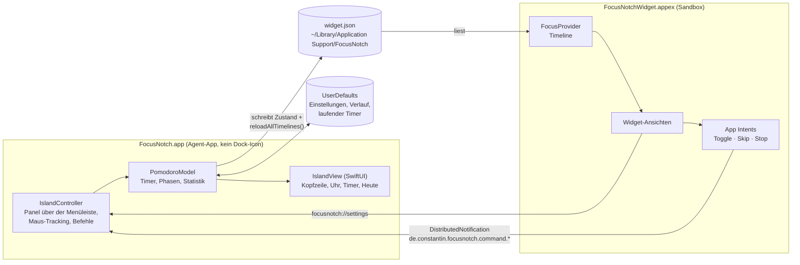
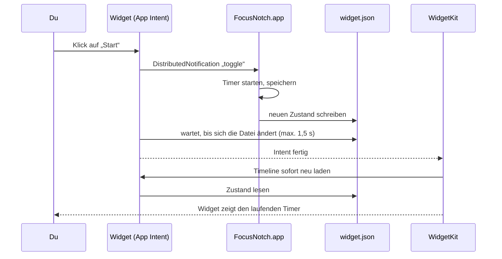

<p align="center">
  
</p>

<h1 align="center">FocusNotch</h1>

<p align="center">
  <b>Ein Pomodoro-Timer als Dynamic Island für die Notch deines MacBooks – mit Desktop-Widget.</b>
</p>

<p align="center">
  
  
  
  
  
</p>

<p align="center">
  
</p>

<h3 align="center">Installieren – eine Zeile im Terminal</h3>

```bash
curl -fsSL https://raw.githubusercontent.com/constantin-loesch/FocusNotch/main/install.sh | bash
```

<p align="center"><sub>macOS 14+ · Apple Silicon · lädt die neueste Version, installiert sie nach /Applications und startet sie</sub></p>

---

## Inhalt

- [Features](#features)
- [Installation](#installation)
- [Bedienung](#bedienung)
- [Architektur](#architektur)
- [Projektstruktur](#projektstruktur)
- [Build-Pipeline](#build-pipeline)
- [Werkzeuge](#werkzeuge)
- [Fehlerbehebung](#fehlerbehebung)
- [Lizenz](#lizenz)

---

## Features

### Immer da – direkt an der Kamera

Links neben der Notch stehen jederzeit der **Start-Button** und die **Zeit** – ohne laufenden Timer die eingestellte Fokuszeit, sonst der Countdown. Rechts zeigt eine **Fortschrittsleiste**, wie weit die Phase ist.

<p align="center">
  <br>
  <sub>Bereit – ein Klick startet 25 Minuten Fokus</sub>
</p>
<p align="center">
  <br>
  <sub>Timer läuft – Anhalten und Überspringen direkt neben der Zeit</sub>
</p>

### Aufklappen mit der Maus

Fährt die Maus auf die Notch, klappt die Island auf. Die Buttons der Kopfzeile bleiben dabei **genau an ihrer Stelle** – man kann sofort klicken.

<p align="center">
  
</p>

| Bereich | Inhalt |
|---|---|
| **Links** | Digitaluhr mit Sekunden und Datum, darunter **Pause/Weiter**, **Überspringen**, **Stoppen** |
| **Mitte** | Runder Timer mit Restzeit und Phase |
| **Rechts** | **Heute:** Fokuszeit und Pausenzeit (live) · **Sessions der letzten 14 Tage** als Kästchen mit Anzahl pro Tag – die Farbintensität passt sich automatisch an deinen besten Tag an |

### Einstellungen

Ein Klick aufs Zahnrad: Längen von Fokus, kurzer und langer Pause, nach wie vielen Sessions die lange Pause kommt, **Akzentfarbe**, Pause automatisch starten, Ton, Beim Login starten und Statistik zurücksetzen.

<p align="center">
  
</p>

### Eine Farbe – deine Wahl

Die ganze App (Island, Buttons, Graph und Widget) nutzt genau **eine Akzentfarbe**. Neun stehen zur Wahl:

<p align="center">
  
</p>

### Desktop-Widget

Zwei Größen für den Schreibtisch. Die Buttons sind **echte Widget-Buttons** (App Intents): Sie reagieren sofort, ohne die App in den Vordergrund zu holen.

<p align="center">
  
</p>

- **Klein:** Zeit, heutige Fokuszeit, Start/Pause
- **Mittel:** zusätzlich Überspringen, Stoppen, Fortschrittsbalken, Heute-Werte, Sessions der letzten 14 Tage und ein Zahnrad, das die Einstellungen in der Island öffnet

### Außerdem

- Ton am Ende jeder Phase, danach startet die Pause automatisch (abschaltbar)
- Jede 4. Pause ist eine lange Pause (einstellbar)
- Ein laufender oder pausierter Timer übersteht einen Neustart der App
- Kein Dock-Icon, kein Fenster – nur die Island
- Funktioniert auch auf Bildschirmen ohne Notch (Island mittig in der Menüleiste)

---

## Installation

### Schnell: fertige App laden

```bash
curl -fsSL https://raw.githubusercontent.com/constantin-loesch/FocusNotch/main/install.sh | bash
```

Das Skript ([install.sh](install.sh)) prüft macOS-Version und Prozessor, lädt `FocusNotch.zip` aus dem [neuesten Release](https://github.com/constantin-loesch/FocusNotch/releases/latest), installiert die App nach `/Applications` (ohne Admin-Rechte nach `~/Applications`), meldet das Widget an und startet FocusNotch. Ein erneuter Aufruf aktualisiert auf die neueste Version.

Deinstallieren:

```bash
curl -fsSL https://raw.githubusercontent.com/constantin-loesch/FocusNotch/main/install.sh | bash -s -- --uninstall
```

> **Warum Terminal statt Download-Button?** FocusNotch ist nicht von Apple notarisiert (dafür braucht es einen kostenpflichtigen Developer-Account). Eine im Browser heruntergeladene App würde macOS beim ersten Start blockieren. Per Terminal geladene Dateien werden nicht als „aus dem Internet“ markiert, deshalb startet die App ohne Rückfrage.

### Selbst bauen

#### Voraussetzungen

- macOS 14 (Sonoma) oder neuer, Apple Silicon
- **Xcode Command Line Tools** – das volle Xcode ist nicht nötig:

```bash
xcode-select --install
```

#### Bauen und installieren

```bash
git clone https://github.com/constantin-loesch/FocusNotch.git
cd FocusNotch
./build.sh install
```

`./build.sh install` baut App und Widget, kopiert `FocusNotch.app` nach `/Applications`, meldet sie bei macOS an und startet sie. Nur bauen (ohne Installation) geht mit `./build.sh`.

### Widget hinzufügen

Rechtsklick auf den Schreibtisch → **Widgets bearbeiten…** → nach **FocusNotch** suchen → klein oder mittel auf den Schreibtisch ziehen.

### Automatisch starten

In der Island: Zahnrad → **Beim Login starten**. Empfehlenswert, weil die Widget-Buttons die laufende App steuern.

---

## Bedienung

| Aktion | Island | Widget |
|---|---|---|
| Fokus starten | ▶ neben der Zeit oder **Start** | **Start** |
| Anhalten / fortsetzen | ⏸ / ▶ neben der Zeit oder **Pause/Weiter** | **Pause/Weiter** |
| Überspringen | ⏭ – Fokus → Pause, Pause → Ende | ⏭ (mittel) |
| Stoppen | ⏹ unter der Uhrzeit | ⏹ (mittel) |
| Einstellungen | Zahnrad rechts oben | Zahnrad (mittel) |
| Beenden | Power-Symbol rechts oben | – |

**Gezählt wird so:** Eine *Session* ist eine vollständig abgeschlossene Fokusphase. Die *Fokus-* und *Pausenzeit* von heute enthält jede tatsächlich verbrachte Minute – auch von übersprungenen oder gestoppten Phasen und von der gerade laufenden.

---

## Architektur

FocusNotch besteht aus zwei Programmen, die gemeinsamen Code teilen: der **App** (Island) und der **Widget-Extension**. Die App ist die einzige Stelle, an der der Timer läuft und Daten gespeichert werden. Das Widget zeigt nur an und schickt Befehle.



### Ein Klick im Widget



Warum so? Ein sichtbares Widget darf auf Anfrage der App höchstens **alle 5 Sekunden** neu gezeichnet werden. Nach einem App Intent lädt WidgetKit dagegen sofort neu – deshalb laufen die Widget-Buttons als Intents und nicht als Links.

### Datenhaltung

| Ort | Inhalt |
|---|---|
| `UserDefaults` (`de.constantin.focusnotch`) | `settings` (Einstellungen), `sessions` (Verlauf aller Fokus- und Pausenphasen), `run` (laufender/pausierter Timer), `cycle` (Sessions seit der letzten langen Pause) |
| `~/Library/Application Support/FocusNotch/widget.json` | Momentaufnahme für das Widget: Phase, Endzeit, heutige Zeiten, Sessions pro Tag, Akzentfarbe |

Das Widget läuft in der Sandbox und darf über eine Ausnahme-Berechtigung genau diesen einen Ordner lesen (siehe `FocusNotchWidget.entitlements`). Laufende Countdowns zeichnet es selbstständig (`Text(timerInterval:)`), ohne neu geladen zu werden.

---

## Projektstruktur

```
FocusNotch/
├── Sources/
│   ├── FocusNotch/                 # App: die Island
│   │   ├── main.swift              # Einstieg, Agent-App ohne Dock-Icon
│   │   ├── AppDelegate.swift       # Start, Bildschirmwechsel, URL-Befehle
│   │   ├── IslandController.swift  # Panel über der Menüleiste, Maus-Tracking, Befehle vom Widget
│   │   ├── IslandView.swift        # Komplette Oberfläche (SwiftUI)
│   │   └── Model.swift             # Timer-Logik, Verlauf, Statistik, Speichern
│   ├── FocusNotchWidget/           # Widget-Extension
│   │   ├── FocusNotchWidget.swift  # Widget-Definition und Timeline
│   │   ├── WidgetViews.swift       # Kleine und mittlere Ansicht
│   │   ├── TimerIntents.swift      # App Intents für die Widget-Buttons
│   │   └── FocusNotchWidget.entitlements
│   └── Shared/
│       └── Shared.swift            # Phasen, Farben, Datenaustausch, Sessions-Graph
├── Resources/
│   └── AppIcon.icns                # App-Icon (erzeugt von tools/make_icon.sh)
├── tools/
│   ├── common.sh                   # SDK-Auswahl und Helfer für alle Skripte
│   ├── make_intents_metadata.py    # Erzeugt Metadata.appintents (ersetzt Xcode)
│   ├── make_icon.sh                # Rendert das Logo → AppIcon.icns + logo.png
│   ├── Icon/                       # Logo als SwiftUI-Ansicht
│   ├── screenshots.sh              # Rendert die Bilder dieser README
│   ├── Screenshots/                # Demo-Daten und Bildkompositionen
│   └── release.sh                  # Baut, zippt und veröffentlicht ein GitHub-Release
├── docs/images/                    # Logo und Screenshots
├── build.sh                        # Bauen, signieren, installieren
├── install.sh                      # Ein-Zeilen-Installer (lädt das neueste Release)
├── VERSION                         # Versionsnummer für App und Release
├── LICENSE
└── README.md
```

---

## Build-Pipeline

FocusNotch wird ohne Xcode gebaut – `build.sh` erledigt alles mit `swiftc` und Bordmitteln von macOS:

1. **SDK wählen** – sucht ein macOS-SDK, das zum installierten Swift-Compiler passt (Command Line Tools bringen oft mehrere mit, nicht jedes passt).
2. **App kompilieren** – `Sources/Shared` + `Sources/FocusNotch` → `build/FocusNotch`.
3. **Widget kompilieren** – `Sources/Shared` + `Sources/FocusNotchWidget` als App-Extension. Wichtig: Einstiegspunkt `_NSExtensionMain`, sonst erkennt macOS das Widget nicht und es stürzt sofort ab.
4. **Bundle zusammensetzen** – `FocusNotch.app` mit Info.plist (Agent-App, URL-Schema `focusnotch://`, Icon) und `PlugIns/FocusNotchWidget.appex`.
5. **App-Intents-Metadaten erzeugen** – `tools/make_intents_metadata.py` liest die Swift-Typnamen aus dem Binary und schreibt `Metadata.appintents`. Das macht sonst Xcode; ohne diese Datei funktionieren die Widget-Buttons nicht.
6. **Signieren** – Ad-hoc, erst das Widget mit Sandbox-Berechtigungen, dann die App.
7. **Installieren** (`install`) – nach `/Applications` kopieren, bei LaunchServices anmelden (die Kopie im Projektordner wird abgemeldet, damit das Widget nicht doppelt erscheint) und starten.

### Neue Version veröffentlichen

1. Versionsnummer in `VERSION` erhöhen und committen.
2. `./tools/release.sh` ausführen – baut die App, packt `FocusNotch.zip` und erstellt das Release `v<VERSION>` auf GitHub (GitHub-CLI muss angemeldet sein: `gh auth login`).
3. Der Installer holt ab sofort automatisch diese Version.

---

## Werkzeuge

| Befehl | Zweck |
|---|---|
| `./build.sh` | App und Widget bauen (`FocusNotch.app` im Projektordner) |
| `./build.sh install` | Bauen, nach `/Applications` installieren, starten |
| `./tools/make_icon.sh` | Logo neu rendern → `Resources/AppIcon.icns`, `docs/images/logo.png` |
| `./tools/screenshots.sh` | README-Bilder neu rendern → `docs/images/` |
| `./tools/release.sh` | Bauen, `FocusNotch.zip` packen und als GitHub-Release `v<VERSION>` veröffentlichen |
| `install.sh` | Installer für Nutzer (lädt das neueste Release) |

Die Screenshots entstehen aus den **echten SwiftUI-Ansichten** der App und des Widgets mit Demo-Daten. Die Widget-Daten werden dabei über `FOCUSNOTCH_SHARED_DIR` in einen temporären Ordner umgeleitet, deine echten Daten bleiben unberührt.

---

## Fehlerbehebung

**Das Widget taucht nicht in der Galerie auf.**
App einmal aus `/Applications` starten (`./build.sh install`). Prüfen, ob macOS es kennt:

```bash
pluginkit -m -v -p com.apple.widgetkit-extension | grep -i focusnotch
```

**Das Widget zeigt alte Daten oder bleibt leer.**
Widget-Dienst neu starten – er startet sich selbst sofort wieder:

```bash
killall chronod
```

**Die Widget-Buttons tun nichts.**
FocusNotch muss laufen (Island oben sichtbar). Am besten „Beim Login starten“ aktivieren.

**Logs ansehen.** In zsh ist `log` ein eingebauter Befehl, daher den vollen Pfad nutzen:

```bash
/usr/bin/log show --last 5m --style compact --predicate 'process == "FocusNotchWidget"'
```

Absturzberichte landen in `~/Library/Logs/DiagnosticReports/` (Dateien mit `FocusNotch` im Namen).

---

## Lizenz

FocusNotch steht unter der [MIT-Lizenz](LICENSE).
