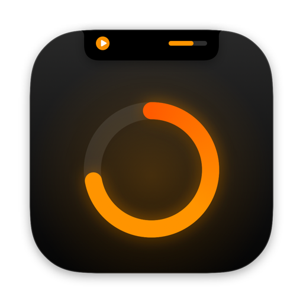
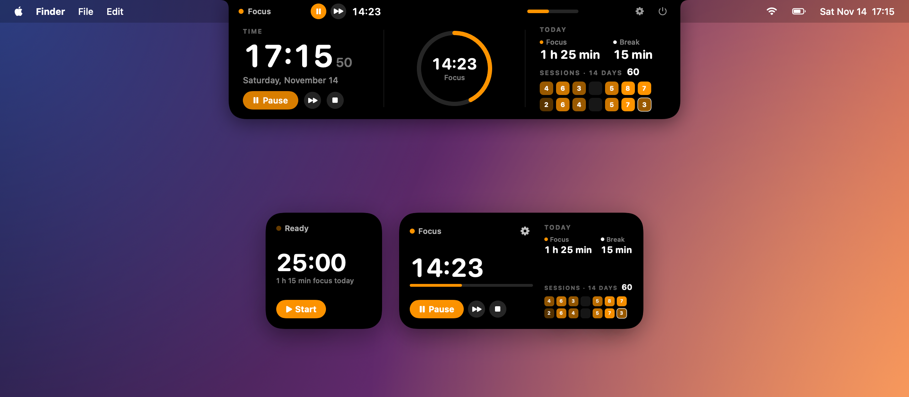
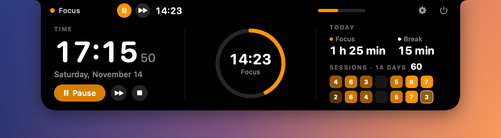
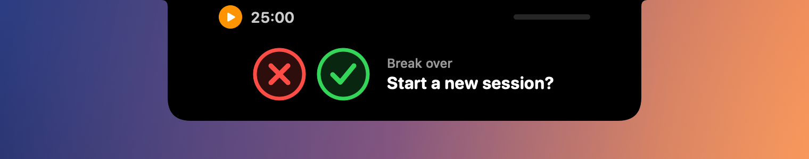
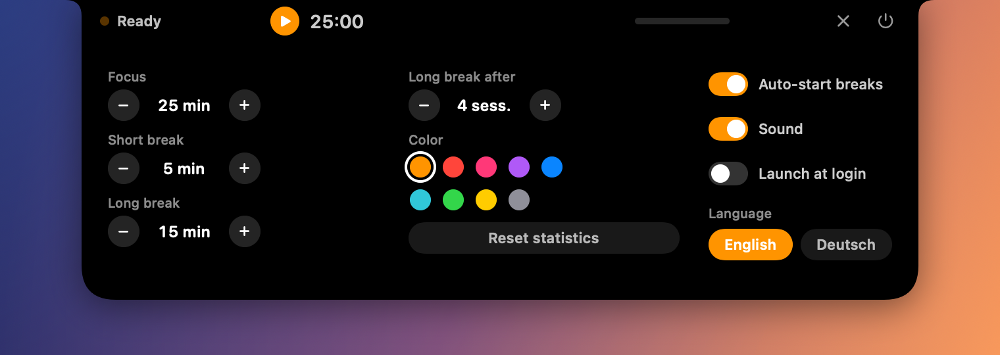
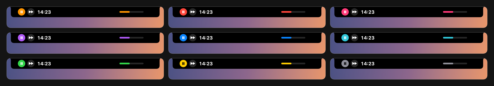
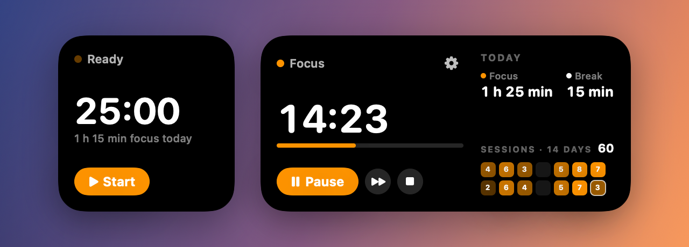
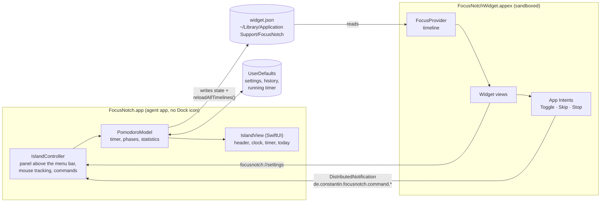
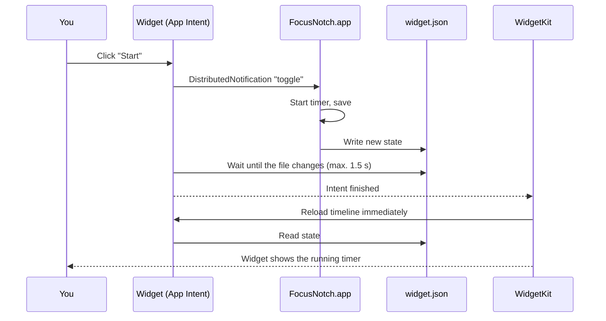

<p align="center">
  
</p>

<h1 align="center">FocusNotch</h1>

<p align="center">
  <b>A Pomodoro timer that lives in your MacBook's notch as a Dynamic Island – with a desktop widget.</b>
</p>

<p align="center">
  
  
  
  
  
</p>

<p align="center">
  
</p>

<h3 align="center">Install – one line in Terminal</h3>

```bash
curl -fsSL https://raw.githubusercontent.com/constantin-loesch/FocusNotch/main/install.sh | bash
```

<p align="center"><sub>macOS 14+ · Apple silicon · downloads the latest version, installs it to /Applications and launches it</sub></p>

---

## Contents

- [Features](#features)
- [Installation](#installation)
- [Usage](#usage)
- [Architecture](#architecture)
- [Project structure](#project-structure)
- [Build pipeline](#build-pipeline)
- [Tools](#tools)
- [Troubleshooting](#troubleshooting)
- [License](#license)

---

## Features

### Always there – right next to the camera

To the left of the notch you always see the **start button** and the **time** – the configured focus length when idle, the countdown while running. To the right, a **progress bar** shows how far along the current phase is (can be turned off in the settings – the island then only extends to the left).

<p align="center">
  <br>
  <sub>Ready – one click starts 25 minutes of focus</sub>
</p>
<p align="center">
  <br>
  <sub>Running – pause and skip right next to the time</sub>
</p>
<p align="center">
  <br>
  <sub>Progress bar turned off – the island ends right at the camera</sub>
</p>

### Hover to expand

Move the mouse onto the notch and the island expands. The header buttons **stay exactly where they are**, so you can click immediately.

<p align="center">
  
</p>

| Area | Content |
|---|---|
| **Left** | Digital clock with seconds and date, below it **Pause/Resume**, **Skip**, **Stop** |
| **Center** | Round timer with remaining time and phase |
| **Right** | **Today:** focus time and break time (live) · **Sessions of the last 14 days** as boxes with the count per day – the color intensity adapts automatically to your best day |

### Focus complete

When a focus phase ends, the island drops down for about 2.5 seconds: a green check draws itself, then the island closes again on its own – and the break starts.

<p align="center">
  
</p>

### Break over – next session?

When a break ends, the island asks whether to start the next session. Two big buttons: **✗** dismisses the question, **✓** starts the next focus phase right away. Either way the island closes again. The question stays until you answer it (or start a timer some other way).

<p align="center">
  
</p>

### Settings

Click the gear: focus, short break and long break length, how many sessions until the long break, **accent color**, auto-start breaks, sound, **progress bar** next to the camera (on/off), launch at login, **language** (English / Deutsch) and reset statistics.

<p align="center">
  
</p>

### One color – your choice

The whole app (island, buttons, grid and widget) uses exactly **one accent color**. Pick one of nine:

<p align="center">
  
</p>

### Desktop widget

Two sizes for your desktop. The buttons are **real widget buttons** (App Intents): they react instantly without bringing the app to the front.

<p align="center">
  
</p>

- **Small:** time, today's focus time, start/pause
- **Medium:** plus skip, stop, progress bar, today's stats, sessions of the last 14 days and a gear that opens the settings in the island

### Also

- A sound at the end of every phase; after a focus phase the break starts automatically (can be turned off), after a break you choose whether to continue
- Every 4th break is a long break (configurable); after an hour without a new session the cycle starts over
- A running or paused timer survives an app restart
- **Bilingual:** English and German, switchable in the settings (starts in your Mac's system language); the widget follows along
- No Dock icon, no window – just the island
- Also works on displays without a notch (island centered in the menu bar)

---

## Installation

### Quick: download the ready-made app

```bash
curl -fsSL https://raw.githubusercontent.com/constantin-loesch/FocusNotch/main/install.sh | bash
```

The script ([install.sh](install.sh)) checks your macOS version and processor, downloads `FocusNotch.zip` from the [latest release](https://github.com/constantin-loesch/FocusNotch/releases/latest), installs the app to `/Applications` (or `~/Applications` without admin rights), registers the widget and launches FocusNotch. Running it again updates to the latest version.

Uninstall:

```bash
curl -fsSL https://raw.githubusercontent.com/constantin-loesch/FocusNotch/main/install.sh | bash -s -- --uninstall
```

> **Why Terminal instead of a download button?** FocusNotch isn't notarized by Apple (that requires a paid developer account). An app downloaded in the browser would be blocked by macOS on first launch. Files downloaded via Terminal aren't marked as "from the internet", so the app launches without a prompt.

### Build it yourself

#### Requirements

- macOS 14 (Sonoma) or later, Apple silicon
- **Xcode Command Line Tools** – the full Xcode is not needed:

```bash
xcode-select --install
```

#### Build and install

```bash
git clone https://github.com/constantin-loesch/FocusNotch.git
cd FocusNotch
./build.sh install
```

`./build.sh install` builds the app and the widget, copies `FocusNotch.app` to `/Applications`, registers it with macOS and launches it. To only build (without installing) run `./build.sh`.

### Add the widget

Right-click the desktop → **Edit Widgets…** → search for **FocusNotch** → drag the small or medium widget onto the desktop.

### Launch automatically

In the island: gear → **Launch at login**. Recommended, because the widget buttons control the running app.

---

## Usage

| Action | Island | Widget |
|---|---|---|
| Start focus | ▶ next to the time or **Start** | **Start** |
| Pause / resume | ⏸ / ▶ next to the time or **Pause/Resume** | **Pause/Resume** |
| Skip | ⏭ – focus → break, break → end | ⏭ (medium) |
| Stop | ⏹ below the clock | ⏹ (medium) |
| Settings | Gear, top right | Gear (medium) |
| Quit | Power icon, top right | – |

**How it counts:** a *session* is a fully completed focus phase. Today's *focus* and *break time* includes every minute actually spent – also from skipped or stopped phases and from the one currently running.

---

## Architecture

FocusNotch consists of two programs that share code: the **app** (the island) and the **widget extension**. The app is the only place where the timer runs and data is stored. The widget only displays and sends commands.



### A click in the widget



Why like this? When the app asks for it, a visible widget may be redrawn at most **every 5 seconds**. After an App Intent, WidgetKit reloads immediately – that's why the widget buttons are intents rather than links.

### Data storage

| Location | Content |
|---|---|
| `UserDefaults` (`de.constantin.focusnotch`) | `settings` (incl. accent color and language), `sessions` (history of all focus and break phases), `run` (running/paused timer), `cycle` (sessions since the last long break), `idleSince` (when the timer last went idle – resets the cycle after an hour) |
| `~/Library/Application Support/FocusNotch/widget.json` | Snapshot for the widget: phase, end time, today's times, sessions per day, accent color, language |

The widget runs sandboxed and may read exactly this one folder through an exception entitlement (see `FocusNotchWidget.entitlements`). It draws running countdowns on its own (`Text(timerInterval:)`) without being reloaded.

---

## Project structure

```
FocusNotch/
├── Sources/
│   ├── FocusNotch/                 # App: the island
│   │   ├── main.swift              # Entry point, agent app without Dock icon
│   │   ├── AppDelegate.swift       # Launch, display changes, URL commands
│   │   ├── IslandController.swift  # Panel above the menu bar, mouse tracking, widget commands
│   │   ├── IslandView.swift        # The entire UI (SwiftUI)
│   │   └── Model.swift             # Timer logic, history, statistics, persistence
│   ├── FocusNotchWidget/           # Widget extension
│   │   ├── FocusNotchWidget.swift  # Widget definition and timeline
│   │   ├── WidgetViews.swift       # Small and medium views
│   │   ├── TimerIntents.swift      # App Intents for the widget buttons
│   │   └── FocusNotchWidget.entitlements
│   └── Shared/
│       └── Shared.swift            # Phases, colors, data exchange, sessions grid
├── Resources/
│   └── AppIcon.icns                # App icon (generated by tools/make_icon.sh)
├── tools/
│   ├── common.sh                   # SDK selection and helpers for all scripts
│   ├── make_intents_metadata.py    # Generates Metadata.appintents (replaces Xcode)
│   ├── make_icon.sh                # Renders the logo → AppIcon.icns + logo.png
│   ├── Icon/                       # The logo as a SwiftUI view
│   ├── screenshots.sh              # Renders the images in this README
│   ├── Screenshots/                # Demo data and image compositions
│   └── release.sh                  # Builds, zips and publishes a GitHub release
├── docs/images/                    # Logo, screenshots, social preview
├── build.sh                        # Build, sign, install
├── install.sh                      # One-line installer (downloads the latest release)
├── VERSION                         # Version number for the app and releases
├── LICENSE
└── README.md
```

---

## Build pipeline

FocusNotch is built without Xcode – `build.sh` does everything with `swiftc` and macOS built-ins:

1. **Pick an SDK** – finds a macOS SDK that matches the installed Swift compiler (the Command Line Tools often ship several, not all of them fit).
2. **Compile the app** – `Sources/Shared` + `Sources/FocusNotch` → `build/FocusNotch`.
3. **Compile the widget** – `Sources/Shared` + `Sources/FocusNotchWidget` as an app extension. Important: entry point `_NSExtensionMain`, otherwise macOS doesn't recognize the widget and it crashes immediately.
4. **Assemble the bundle** – `FocusNotch.app` with its Info.plist (agent app, `focusnotch://` URL scheme, icon) and `PlugIns/FocusNotchWidget.appex`.
5. **Generate App Intents metadata** – `tools/make_intents_metadata.py` reads the Swift type names from the binary and writes `Metadata.appintents`. Xcode normally does this; without the file the widget buttons don't work.
6. **Sign** – ad hoc, first the widget with its sandbox entitlements, then the app.
7. **Install** (`install`) – copy to `/Applications`, register with LaunchServices (the copy in the project folder is unregistered so the widget doesn't show up twice) and launch.

### Publishing a new version

1. Bump the version in `VERSION` and commit.
2. Run `./tools/release.sh` – builds the app, packs `FocusNotch.zip` and creates the release `v<VERSION>` on GitHub (the GitHub CLI must be logged in: `gh auth login`).
3. From then on the installer automatically fetches this version.

---

## Tools

| Command | Purpose |
|---|---|
| `./build.sh` | Build the app and widget (`FocusNotch.app` in the project folder) |
| `./build.sh install` | Build, install to `/Applications`, launch |
| `./tools/make_icon.sh` | Re-render the logo → `Resources/AppIcon.icns`, `docs/images/logo.png` |
| `./tools/screenshots.sh` | Re-render the README images and the social preview → `docs/images/` (`FOCUSNOTCH_LANG=de` for German) |
| `./tools/release.sh` | Build, pack `FocusNotch.zip` and publish it as GitHub release `v<VERSION>` |
| `install.sh` | Installer for users (downloads the latest release) |

The screenshots are rendered from the **real SwiftUI views** of the app and the widget with demo data. The widget data is redirected to a temporary folder via `FOCUSNOTCH_SHARED_DIR`, so your real data stays untouched.

---

## Troubleshooting

**The widget doesn't show up in the gallery.**
Launch the app once from `/Applications` (`./build.sh install`). Check whether macOS knows it:

```bash
pluginkit -m -v -p com.apple.widgetkit-extension | grep -i focusnotch
```

**The widget shows old data or stays empty.**
Restart the widget service – it immediately restarts itself:

```bash
killall chronod
```

**The widget buttons do nothing.**
FocusNotch has to be running (island visible at the top). Best enable "Launch at login".

**Viewing logs.** In zsh, `log` is a built-in command, so use the full path:

```bash
/usr/bin/log show --last 5m --style compact --predicate 'process == "FocusNotchWidget"'
```

Crash reports end up in `~/Library/Logs/DiagnosticReports/` (files with `FocusNotch` in their name).

---

## License

FocusNotch is released under the [MIT License](LICENSE).
